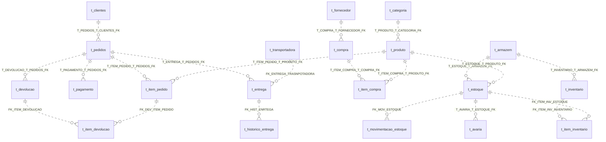
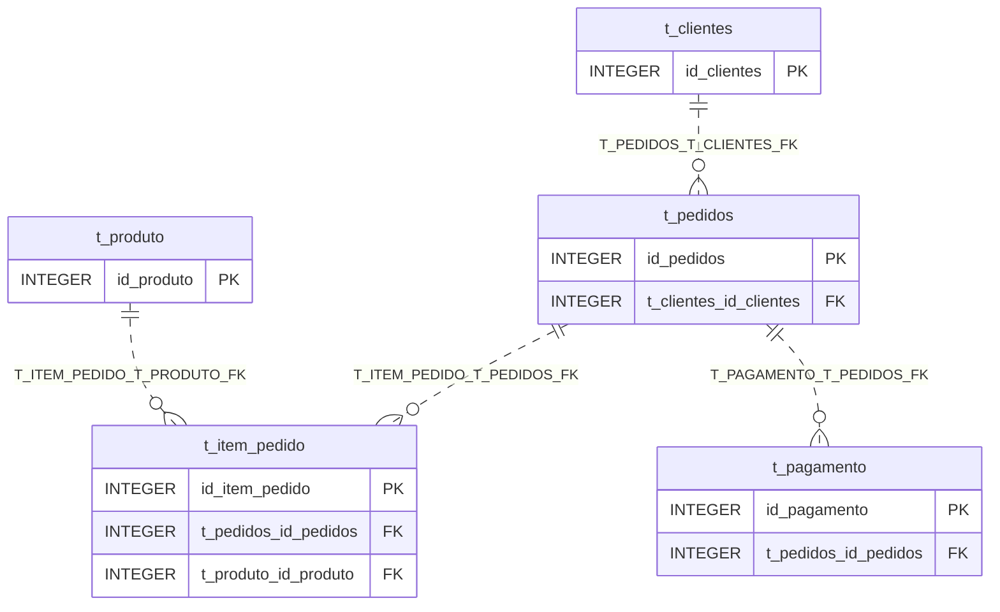
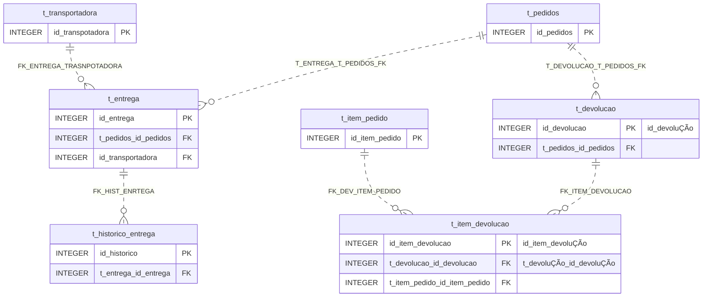
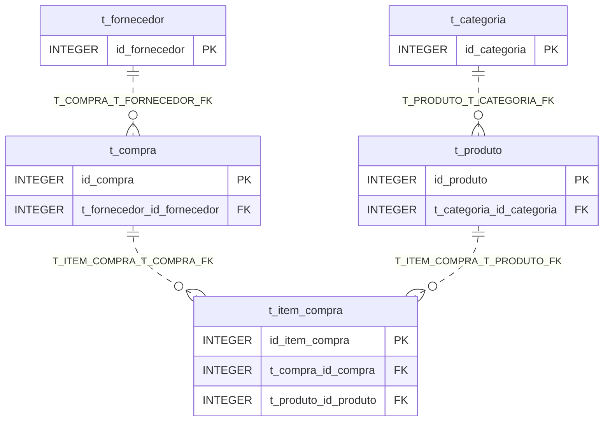
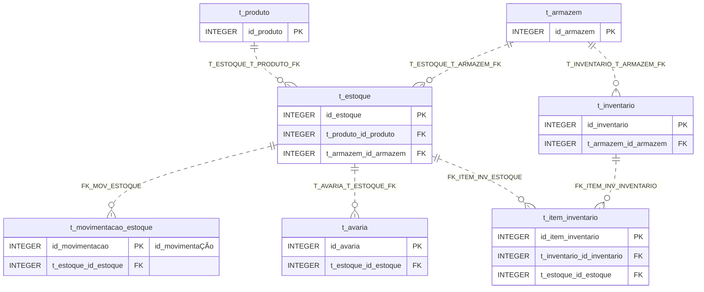

# Modelo relacional da versão 1

Este documento descreve o esquema efetivamente criado por [`demo/v1/00_schema.sql`](../demo/v1/00_schema.sql),
que inclui a [proposta PostgreSQL revisada](ddl_historico/propostas/trabalho_logistico_postgresql_REVISAO_OFFLINE_NAO_EXECUTAR.sql)
(a fonte única do DDL; este documento não a altera). Os nomes físicos foram conferidos
com essa fonte e com as colunas de [`demo/v1/02_load.sql`](../demo/v1/02_load.sql).

**Situação.** Os diagramas foram escritos manualmente a partir do DDL.
Os cinco diagramas foram conferidos visualmente pelo autor no GitHub.
Essa conferência foi visual e manual, não um teste automatizado. Se algum bloco não
for exibido em outro visualizador, as tabelas deste arquivo contêm a mesma
informação em texto. O esquema descrito foi o criado na execução manual relatada em
[`demo/v1/README.md`](../demo/v1/README.md); a contagem de 20 tabelas, 140 colunas,
20 PKs, 21 FKs e 1 CHECK vem da leitura do DDL e dessa execução.

## Como ler os diagramas

- Cada FK é uma linha de `tabela_pai ||..o{ tabela_filha`. A linha pontilhada (`..`)
  indica relação **não identificadora**: em nenhuma tabela a coluna FK integra a PK da
  filha, que é sempre uma coluna própria `id_*`. Todas as colunas FK são
  `NOT NULL`, então toda linha-filha exige exatamente um pai (`||` no lado do pai).
  Nenhuma restrição obriga o pai a ter filhos nem limita a quantidade deles
  (`o{`: zero ou mais). Não há `UNIQUE` em colunas FK, logo todas são relações um-para-muitos.
- Cada linha traz o nome da constraint, como escrito no DDL (o PostgreSQL converte
  identificadores sem aspas ASCII para minúsculas). Exceção por compatibilidade
  visual: a constraint `T_DEVOLUÇÃO_T_PEDIDOS_FK` aparece sem acento como
  `T_DEVOLUCAO_T_PEDIDOS_FK`.
- As tabelas mostram **apenas PKs e FKs**. As demais colunas estão na seção
  [Colunas não chave](#colunas-não-chave-e-restrições).
- Os identificadores de entidades e colunas nos diagramas são **ASCII**, por compatibilidade
  com a sintaxe Mermaid. Quando o nome físico tem letra acentuada, o diagrama usa a forma sem
  acento e a [tabela de nomes físicos](#nomes-físicos-com-acentos-e-grafias-existentes)
  traz o nome exato. É uma simplificação visual; não existe tabela ou coluna ASCII equivalente
  no banco.
- Tabelas que pertencem a outro domínio aparecem apenas com a PK (referência cruzada).
- Não há views, triggers, funções nem sequências no DDL; nada disso é representado.
- Não há vínculo entre item de pedido e remessa, nem entre reembolso e pagamento; este
  modelo não os representa.

## Visão geral: as 21 FKs

## Domínio A — Pedidos e pagamentos

`t_produto` pertence ao domínio C. Um pedido pode ter vários pagamentos (tentativas
pendentes, recusadas ou aprovadas na mesma tabela); o esquema não impede que a soma
exceda o total do pedido.

## Domínio B — Entregas e devoluções

Pontos de leitura:

- A entrega referencia o **pedido**, não o item. Não há vínculo entre item de pedido
  e remessa.
- A devolução referencia o **pedido**; o item de devolução referencia a devolução e o item
  de pedido. O esquema não obriga que o item pertença ao mesmo pedido da devolução.
  Esse ponto foi verificado em `03_validate.sql` sobre os dados carregados.
- O reembolso é a coluna `valor_reembolso` de `t_devolucao`; não há FK para `t_pagamento`.
- A PK de `t_transportadora` é `id_transpotadora` (grafia existente, sem o segundo
  «r»), enquanto a FK em `t_entrega` é `id_transportadora`.

## Domínio C — Catálogo e compras

Não há FK entre produto e fornecedor; o fornecedor se liga ao produto apenas por
compras e itens de compra.

## Domínio D — Estoque, movimentação, avarias e inventário

`t_estoque` é a ligação entre produto e armazém. Não há `UNIQUE` em
(produto, armazém), portanto o esquema não impede mais de uma linha de estoque para a
mesma combinação. A avaria e a movimentação referenciam a linha de estoque; o vínculo
entre avaria e movimentação (documento `AVARIA:<id>`) é uma convenção dos dados,
verificada em `03_validate.sql`, e não uma FK.

## Cobertura das 20 tabelas

| # | Tabela física | PK física | FKs de saída | Domínio principal | Também aparece (só PK) em |
|---:|---|---|---:|---|---|
| 1 | `t_armazem` | `id_armazem` | 0 | D | — |
| 2 | `t_avaria` | `id_avaria` | 1 | D | — |
| 3 | `t_categoria` | `id_categoria` | 0 | C | — |
| 4 | `t_clientes` | `id_clientes` | 0 | A | — |
| 5 | `t_compra` | `id_compra` | 1 | C | — |
| 6 | `t_devolucao` | `id_devoluÇÃo` | 1 | B | — |
| 7 | `t_entrega` | `id_entrega` | 2 | B | — |
| 8 | `t_estoque` | `id_estoque` | 2 | D | — |
| 9 | `t_fornecedor` | `id_fornecedor` | 0 | C | — |
| 10 | `t_historico_entrega` | `id_historico` | 1 | B | — |
| 11 | `t_inventario` | `id_inventario` | 1 | D | — |
| 12 | `t_item_compra` | `id_item_compra` | 2 | C | — |
| 13 | `t_item_devolucao` | `id_item_devoluÇÃo` | 2 | B | — |
| 14 | `t_item_inventario` | `id_item_inventario` | 2 | D | — |
| 15 | `t_item_pedido` | `id_item_pedido` | 2 | A | B |
| 16 | `t_movimentaÇÃo_estoque` | `id_movimentaÇÃo` | 1 | D | — |
| 17 | `t_pagamento` | `id_pagamento` | 1 | A | — |
| 18 | `t_pedidos` | `id_pedidos` | 1 | A | B |
| 19 | `t_produto` | `id_produto` | 1 | C | A, D |
| 20 | `t_transportadora` | `id_transpotadora` | 0 | B | — |

Soma das FKs de saída: 21, igual à quantidade de `FOREIGN KEY` do DDL. Cada FK aparece
uma vez no domínio em que a tabela-filha está e também uma vez na visão geral.

| Domínio | FKs representadas |
|---|---:|
| A — Pedidos e pagamentos | 4 |
| B — Entregas e devoluções | 6 |
| C — Catálogo e compras | 4 |
| D — Estoque | 7 |
| Total | 21 |

## Nomes físicos com acentos e grafias existentes

Os identificadores do DDL não têm aspas: o PostgreSQL converte as letras ASCII
maiúsculas em minúsculas e mantém as letras acentuadas como escritas. Por isso os nomes
abaixo, iguais aos usados com aspas em `demo/v1/02_load.sql`, misturam minúsculas e
`Ç`/`Ã` maiúsculos. Use os identificadores exatos entre aspas duplas, conforme o
carregador.

| Objeto | Nome físico |
|---|---|
| Tabela | `"t_movimentaÇÃo_estoque"` |
| PK | `"id_movimentaÇÃo"` |
| Demais colunas da tabela | `"tipo_movimentação"`, `"data_movimentação"` (minúsculas, como no DDL), `quantidade`, `motivo`, `documento_referencia`, `t_estoque_id_estoque` |
| `t_devolucao` | `"id_devoluÇÃo"`, `"data_solicitaÇÃo"`, `"status_devoluÇÃo"`, `"data_conclusÃo"` |
| `t_item_devolucao` | `"id_item_devoluÇÃo"`, `"condiÇÃo_produto"`, `"t_devoluÇÃo_id_devoluÇÃo"` |
| `t_clientes`, `t_armazem`, `t_estoque` | `"endereÇo"` (clientes e armazém), `"localizaÇÃo"`, `"ultima_atualizaÇÃo"` |
| `t_compra` | `"data_previsÃo"` |
| `t_item_compra` | `"preÇo_unitario"` |
| `t_produto` | `"descriÇao"`, `"preÇo_custo"`, `"peÇo_venda"` (grafia existente: «peço» em vez de «preço») |
| `t_pagamento` | `"codigo_transaÇÃo"` |
| `t_item_inventario`, `t_inventario` | `"diferenÇa"`, `"observaÇÃo"` |
| `t_avaria`, `t_categoria` | `"descriÇÃo"` |
| `t_historico_entrega` | `"observaÇÃo"` |
| Grafias existentes sem acento | `id_transpotadora` (PK de `t_transportadora`), `tipo_trasnporte`, `numero_total` em `t_compra` (texto, não total numérico), constraints `FK_ENTREGA_TRASNPOTADORA` e `FK_HIST_ENRTEGA` |

Os nomes dos CSVs seguem o catálogo do gerador; em `generated_data/full_20261008_1724_ascii`
a tabela de movimentação usa `t_movimentacao_estoque.csv` apenas como nome de arquivo.

## Colunas não chave e restrições

O DDL contém **somente** estas restrições, além das PKs e FKs:

- **`NOT NULL` fora de chaves:** `t_clientes` (`nome`, `cpf_cnpj`, `email`, `endereÇo`),
  `t_fornecedor.telefone`, `t_transportadora.telefone`, `t_item_pedido.quantidade`,
  `t_produto.nome`. Todas as demais colunas não chave são anuláveis, inclusive valores,
  datas e status.
- **Um `CHECK`:** `t_transportadora.tipo_trasnporte IN ('RODOVIARIO ', 'AEREO', 'MARITIMO')`.
  O primeiro valor tem um espaço final, preservado do DDL de origem.
- **Sem** `UNIQUE`, `DEFAULT`, índices adicionais, regras `ON DELETE`/`ON UPDATE`
  (vale o comportamento padrão), colunas geradas, views, triggers ou funções.
- Os identificadores são inteiros informados pelos dados; não há geradores automáticos.

Tipos: datas são `DATE` (granularidade diária), valores monetários são `NUMERIC` com
duas casas, e as colunas de status são `VARCHAR`.

Consequência prática: as regras de negócio (ex.: pagamento integral antes do envio,
pedido concluído apenas com entregas `ENTREGUE`, limite de reembolso, saldo de estoque
conciliado com movimentos) **não** são impostas por este esquema. Elas foram verificadas
sobre o conjunto de dados carregado por `03_validate.sql` e não há garantia para futuras
alterações. Os valores de `status_*`, por exemplo, não têm `CHECK`.
